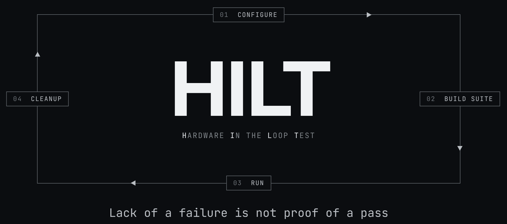

# HILT

**Python HIL testing with a pit of success: composable tests, guardrails
that make a bad test hard to write, and an engine that won't let an unhandled
failure pass silently.**

HILT (Hardware-In-the-Loop Testing) is a test framework for Python. A test is a
component and a rack is a tree of them, built from the same unit you test one bench
DUT with. You write what you claim about the hardware; HILT enforces the verdict,
records the evidence as the test runs, and gives the floor a terminal Inspector for
reading it, so a technician can triage a failure at 2am without calling you.

> *The act of executing the test is the act of producing irrefutable evidence*

## Why

Most test scripts have one way to fail: something raises. A bad unit, a bug in the
test, and a database timeout all raise, and all show up as the same red FAIL. A
failure that doesn't raise doesn't show up at all; it passes. In the former case
the technician on shift guesses or escalates and the line waits for an engineer;
in the latter, a bad unit ships to the customer.

HILT closes both gaps. A test passes only by returning an explicit verdict, so a
failure that never raises cannot pass by default. And every failure it records is
sorted by cause before anyone reads it: bad unit, bad bench, or bad test.

That is what the pit of success is for. The guardrails push the engineer to name
each failure mode while the test is being written, and the engine holds that line
at run time, so the sorting is done before the suite ever reaches the floor. The
same component composes from one bench DUT to a rack, so it is done once. Every
guardrail and every line of the engine is measured against one bar:

> A Floor Technician can correctly categorize a failure and start the right recovery
> protocol **within 60 seconds** of opening the Inspector, without messaging the
> engineer who wrote the test.

## Try it

Requires Python 3.14. The distribution on PyPI is `hilt-core`; the import package
and the console scripts are `hilt`:

```sh
pip install hilt-core        # or: uv add hilt-core
```

To work from a clone instead, with [uv](https://docs.astral.sh/uv/):

```sh
make install
uv run hilt run examples/hello_world.py
uv run hilt inspect
```

A suite is a class, a claim is a method, and a verdict is explicit:

```python
from hilt import PASS, TestComponent, TestFailure, TestUtils, Verdict


class HelloWorld(TestComponent):
    def __init__(self, *, name: str, greeting: str = "hello world") -> None:
        super().__init__(name=name)
        self._greeting = greeting

    def build_suite(self) -> TestComponent:
        return self.test("say hello", self._say_hello)

    async def _say_hello(self, utils: TestUtils) -> Verdict:
        if self._greeting:  # the claim, stated as a condition
            utils.logger.info(self._greeting)  # lands in this node's timeline
            return PASS  # the only way to pass
        raise TestFailure("nothing to say", "a greeting", "(empty)")
```

The **[Getting started guide](docs/getting-started.md)** continues from here: the
examples in teaching order, running against real devices over SSH, and deploying to a
station.

## Three outcomes, never merged

**No pass by default.** "Reached the end without throwing" proves only that none of
the failures you thought of happened. A HILT test passes only by returning the
`PASS` sentinel, which can't be forged from a string, a truthy value, or parsed config.
Declare the readings a pass must carry with `@evidence(...)`, and a pass without them
doesn't count.

Every node ends in exactly one of three states, and each sends the floor down a
different path:

| State | What happened | What the floor does |
|---|---|---|
| **Pass** | The test returned `PASS`, with its declared evidence | Ship it |
| **Fail** | The hardware failed a modeled check (`TestFailure`), **or** the test raised an exception it didn't model. The second case is recorded as Fail with a loud contract-violation banner and `bug: true` | Check the hardware, or hand the flagged bug to the engineer |
| **Aborted** | No verdict exists: the harness or integration layer broke, the operator stopped the rack, a time budget expired, **or** the test returned without `PASS`. That last case is also flagged `bug: true` | Fix the harness or the test. Don't condemn the unit |

Two developer mistakes, two different states, on purpose. An unmodeled exception
carries information about what went wrong, so it is recorded as a Fail and marked as
a bug. A method that falls off the end produces nothing, and HILT will not forge a
verdict from nothing, so the node is Aborted and marked as a bug. Both are loud. Neither
takes down the sibling DUTs running beside it.

## What you get

**Evidence is a side effect of running.** Each run writes a timestamped directory with
a versioned `result.json`, a human `timeline.log` and machine `timeline.jsonl` per node,
and point-in-time artifacts stitched onto that timeline. Entries are flushed as they are
written, so an interrupted run keeps its chronology up to the moment it stopped. With
NTP-synced stations, that timeline holds up in a customer dispute.

**One building block, bench to rack.** `TestComponent` is the only unit. A leaf check, an
ordered `sequence()`, a concurrent `parallel()`, a whole device, and a full rack are the
same type, composed. No level knows what sits above it, so the test tree mirrors the
hardware tree.

**Guardrails your team can't bypass.** Rules are enforced at runtime (one child
boundary owns the verdict, the failure taxonomy, and lifecycle order, and `cleanup`
always runs), at import time (a structurally broken suite refuses to load), and by
static analysis (`hilt-check` flags an ungated `PASS`). Nothing that protects the
hardware or the verdict relies on the linter alone.

**Safe aborts.** When the integration layer fails mid-run or the operator hits Ctrl-C,
HILT closes every in-flight transport across the tree: SSH sessions destroyed,
subprocesses killed. A 30-minute firmware flash doesn't keep writing to a board after
the run is called off. Start and finish hooks stay paired, so your MES never gets
orphan rows.

**Less plumbing.** Call `utils.use_shell()` in `configure()` and every descendant's
`utils.exec` runs over that SSH hop, jump hosts included. Serial consoles and HTTP/CoAP
device APIs route the same way. `wait_for()` requires a `looking_for=` description that
becomes the timeout message the technician reads. Time budgets (`fail_after=` /
`abort_after=`) attach to any node, and a child can only tighten its parent's budget.

## The Inspector

`hilt inspect` opens any saved run in a terminal UI built for the person at the
station. The **Inspect** tab replays the evidence. The **Re-Run** tab re-runs any branch
or leaf of the tree with the exact production code, without touching the production
record.

```text
  [ Inspect ]   Re-Run
  ---------------------------------------------------------
    rack  Aborted
    └─ servers  Aborted  ←
       ├─ server-01  Pass
       ├─ server-02  Fail
  >    │  └─ thermal check  Fail  not taken: fan_rpm
       ├─ server-03  Aborted
       └─ firmware check  Pending
  ---------------------------------------------------------
  log: rack/servers  (rolled up: thermal check has no own log)
  page 4/7  errors only: off  captures: 1  (1-9 opens a capture)
      14:02:11Z info     starting thermal ramp
  [1] 14:02:45Z info     survey captured
      14:03:02Z error    temperature 87 C exceeds 75 C
  q Quit  Tab Inspect / Re-Run  ← → failures  h Hide passes  n p page  f Errors only
```

- **← / →** jump between failures, skipping everything that passed. **h** folds the
  passing branches out of a large rack.
- The highlighted node's timeline follows the cursor. **1–9** open captured artifacts.
- Missing readings are shown as **not taken** by name, so an absent value is never
  mistaken for zero.

The same record is available as versioned JSON (`--json`, with
[published schemas](docs/schema/)) and as JUnit XML (`--junit`) for CI and dashboards.

## Documentation

- [Getting started](docs/getting-started.md): install, first run, examples, deployment
- [Overview](docs/overview.md): the philosophy and the failure taxonomy
- [Contracts](docs/contracts.md): what the framework guarantees and what it asks of you
- [Idioms](docs/idioms.md): authoring patterns
- [Inspector](docs/inspector.md) and [Floor Technician guide](docs/floor-technician.md):
  the station side
- [API stability](docs/api-stability.md): the public surface and versioning policy

GitLab renders every page under
https://gitlab.com/Tyler-Meador/HILT/-/tree/main/docs. Each release branch
also carries the built site under `docs/site/`, so a station can open it from a clone
with no network. The
[Floor Technician guide](https://gitlab.com/Tyler-Meador/HILT/-/blob/main/docs/floor-technician.md)
is the URL that belongs on a station label.

## Status

HILT is at 0.0.x and the API is still moving. Semantic versioning starts at 1.0.0;
until then [API stability](docs/api-stability.md) describes what may change and
`CHANGELOG.md` records every change. Issues and merge requests are welcome.

## License

Copyright 2026 Tyler Meador. HILT is released under the Apache
License, Version 2.0. The full text is in `LICENSE`; the copyright notice is in
`NOTICE`. There is no warranty; see the license for the terms.
