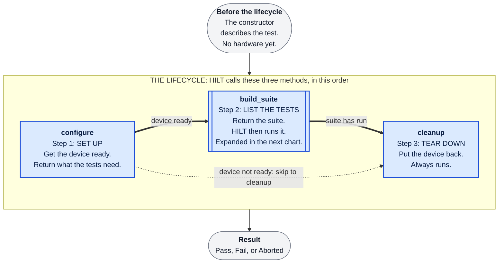
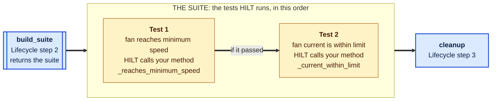
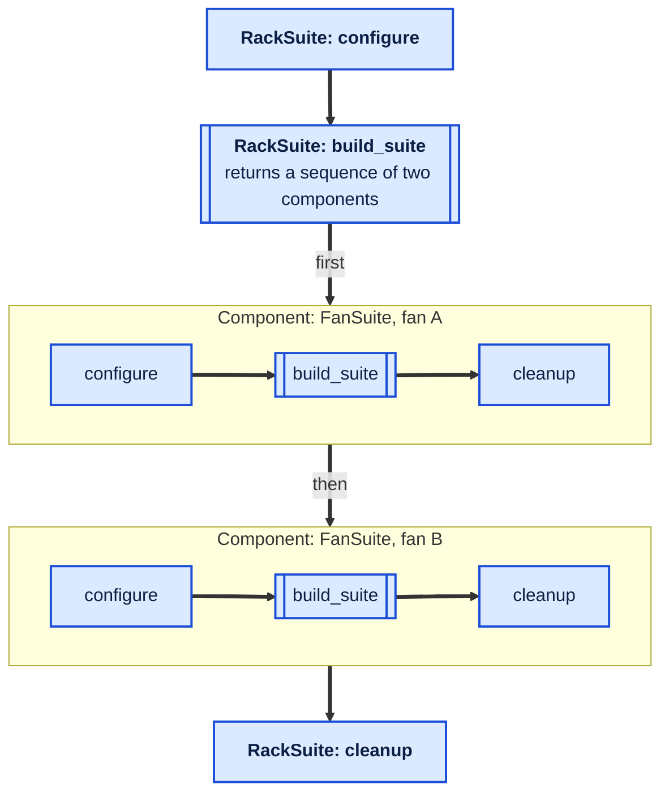

# The lifecycle

Every `TestComponent` has a lifecycle of three methods: `configure`, `build_suite`,
and `cleanup`. HILT calls them in that order on every run and enforces the contract of
each.



If you have written a bench procedure, you know the shape: **set up, run the checks,
tear down**. The difference is that HILT owns the order. You never call these methods
yourself, and HILT runs the teardown after every outcome.

Two things you write are *not* lifecycle steps:

- **`__init__`**, the constructor, runs earlier, when the component is created.
- **Test methods** are never called by the lifecycle directly. `build_suite` hands
  them over as part of the suite, which is the next chart.

## What `build_suite` returns

`build_suite` does not run tests. It returns **the suite**: a tree that names each
test and says which method performs it. HILT runs that tree after `build_suite` and
before `cleanup`.



Each test in the suite pairs a name, which is what the technician reads in the report,
with one of your test methods. A test method checks one thing and ends with
`return PASS` or `raise TestFailure`.

A suite is built from four kinds of block. The one above is a `self.sequence` holding
two `self.test` blocks:

| Block | What HILT does with it |
|-------|------------------------|
| `self.test(name, method)` | Calls `method` once and records its verdict under `name`. |
| `self.sequence(name, [...])` | Runs the children in order and stops at the first failure. |
| `self.parallel(name, [...])` | Runs the children at the same time and collects every failure. |
| Another component, such as `FanSuite(name="fan A")` | Runs that component's own lifecycle. See [Components nest](#components-nest). |

The block that `build_suite` returns may leave its name out: `self.sequence([...])`
takes the component's own name. Name it, as the examples here do, when the name adds
something. See [Composition Factories](idioms.md#composition-factories-selftest-selfsequence-selfparallel).

## The same thing in code

A fan test: power it on, check its speed and its current draw, power it off. This is
the component both charts describe.

```python
from typing import Any

from hilt import PASS, TestComponent, TestFailure, TestUtils, Verdict, evidence


class _Fan:
    """A pretend fan so this file runs on any machine. Swap in your real device."""

    def __init__(self) -> None:
        self.powered = False

    def power_on(self) -> None:
        self.powered = True

    def power_off(self) -> None:
        self.powered = False

    def read_rpm(self) -> int:
        return 2000 if self.powered else 0

    def read_current_ma(self) -> int:
        return 180 if self.powered else 0


class FanSuite(TestComponent):
    # Before the lifecycle: describe the test. No hardware yet.
    def __init__(self, *, name: str, min_rpm: int = 1800, max_current_ma: int = 250) -> None:
        super().__init__(name=name)
        self._min_rpm = min_rpm
        self._max_current_ma = max_current_ma

    # LIFECYCLE 1 of 3: set up the device, then return what the tests will need.
    async def configure(self, utils: TestUtils) -> dict[str, Any]:
        fan = _Fan()
        fan.power_on()
        try:
            await utils.wait_for(lambda: fan.read_rpm() > 0, looking_for="fan spinning")
        except TestFailure:
            fan.power_off()  # a failed configure hands cleanup nothing, so undo it here
            raise
        return {"fan": fan, "min_rpm": self._min_rpm, "max_current_ma": self._max_current_ma}

    # LIFECYCLE 2 of 3: return the suite. Name each test and hand over its method.
    def build_suite(self) -> TestComponent:
        return self.sequence(
            "fan checks",
            [
                self.test("fan reaches minimum speed", self._reaches_minimum_speed),
                self.test("fan current is within limit", self._current_within_limit),
            ],
        )

    # LIFECYCLE 3 of 3: put the device back. Runs even if configure or a test failed.
    async def cleanup(self, utils: TestUtils) -> None:
        fan = utils.ctx.get("fan")
        if fan is not None:
            fan.power_off()

    # Test methods are not lifecycle steps. build_suite hands each one to self.test(),
    # and HILT calls it when it runs the suite.
    @evidence("rpm")
    async def _reaches_minimum_speed(self, utils: TestUtils) -> Verdict:
        rpm = utils.ctx["fan"].read_rpm()
        minimum = utils.ctx["min_rpm"]
        if rpm >= minimum:
            return PASS({"rpm": rpm})
        raise TestFailure(
            "fan below minimum speed", f">= {minimum} rpm", f"{rpm} rpm", evidence={"rpm": rpm}
        )

    @evidence("current_ma")
    async def _current_within_limit(self, utils: TestUtils) -> Verdict:
        current_ma = utils.ctx["fan"].read_current_ma()
        limit = utils.ctx["max_current_ma"]
        if current_ma <= limit:
            return PASS({"current_ma": current_ma})
        raise TestFailure(
            "fan draws too much current",
            f"<= {limit} mA",
            f"{current_ma} mA",
            evidence={"current_ma": current_ma},
        )
```

Save it as `fan_suite.py` and run `uv run hilt run fan_suite.py`. It ends with
`hilt run: FanSuite: Pass`.

## What goes where

| | Method | Put here | Keep out |
|-|--------|----------|----------|
| Before the lifecycle | `__init__` | Name, limits, addresses. Anything known up front. | Anything that touches the device. |
| Lifecycle 1 | `configure` | Power-up, connections, waiting until ready. Return a dict of what the tests need. | Checks that deserve their own line in the report. |
| Lifecycle 2 | `build_suite` | The tests, by name, in order. | Any work. It is a plain `def` and reads no hardware. |
| Lifecycle 3 | `cleanup` | Power-down, restoring settings. | Raising errors. Reading ctx with `[]`. |
| Used by the suite | Test method | One measurement and the comparison that judges it. | Setup or teardown for other tests. |

Three rules cover most first-week mistakes:

- **`utils.ctx` holds what `configure` returned.** That is how values reach the test
  methods. It is read-only after `configure`; a test hands its readings back with
  `PASS({...})`.
- **`self` is frozen after `__init__`.** Setting `self.something` later raises an
  error. Use ctx instead.
- **`cleanup` reads ctx with `.get()`.** It also runs when `configure` failed, and
  then ctx holds nothing `configure` would have returned. So a `configure` that fails
  partway undoes what it started, the way the example powers the fan back off.

## Components nest

A `TestComponent` is a self-contained block: it knows how to set itself up, what to
run, and how to clean up after itself. Bigger tests are built by putting blocks inside
blocks, the way an assembly is built from subassemblies. A component placed in a suite
runs its own complete lifecycle there.

```python
class RackSuite(TestComponent):
    def build_suite(self) -> TestComponent:
        return self.sequence("fans", [FanSuite(name="fan A"), FanSuite(name="fan B")])
```



`RackSuite` defines only `build_suite`: `configure` and `cleanup` are optional, for a
component with nothing of its own to set up or put back.

Each component has its own ctx. The tests inside one component share it; a component
nested in another does not see what the outer one's `configure` returned.

## When something goes wrong

For the fan example, whose suite is a sequence:

| What happened | Suite runs? | `cleanup` runs? | Result |
|---------------|-------------|-----------------|--------|
| A test method raises `TestFailure` | Up to the failure | Yes | `Fail`: the claim did not hold |
| `configure` raises `TestFailure` (a `wait_for` timeout does) | No | Yes | `Fail`: the device never became testable |
| `configure` or a test method raises any other exception | Up to the exception | Yes | `Fail`, flagged as a bug in the suite |
| A test method ends without `return PASS` | Up to that test | Yes | `Aborted`: no verdict was given |

In a `self.parallel`, one test failing does not stop the others.

`TestFailure` is a verdict: the device did not pass. Whether the cause is the hardware
or the bench around it is for the person at the station to work out. Any other
exception means the suite itself has a bug. Catch what the device can do wrong and
raise `TestFailure` for it.

## Going further

- **Watching the device during a run.** Surveys snapshot the device at each lifecycle
  boundary, and audits check it on a timer while the suite runs. Both are registered
  in `__init__`; see `examples/hardware_device_lifecycle.py` and [idioms](idioms.md).
- **The exact guarantees.** [Contracts](contracts.md) is the precise statement of what
  the framework promises, starting with the
  [Lifecycle Contract](contracts.md#lifecycle-contract). This page is the short
  version; where the two differ, the contract is right.
- **Authoring patterns.** [Idioms](idioms.md) covers time budgets, evidence, typed
  ctx, and SSH.
